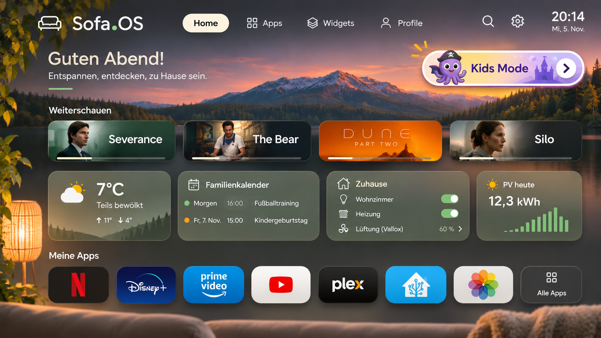

# Sofa.OS

A family TV experience for one household: a remote-friendly screen on a Samsung TV, set up from a phone or computer.



*Early design mockup. It still shows some features that have since been removed.*

## Status

Phase 1 has started. The Server foundation runs on the home server behind Caddy, with Companion sign-in. Layout revisions, their sync to Sofa Home, TV Sign-in by QR code and Sofa Home's remote-driven shell (Dashboard, Apps and Widgets tabs, focus, Settings, app launching) are built; TV Sign-in is verified on the TV, the shell is not yet. The Server's Watch Allowance clock is built and tested with a fake clock and a fake Home Assistant, but has not yet switched the real TV off. See the [implementation plan](docs/implementation-plan.md).

## Development

Needs Node 26.

```bash
npm install
npm run check   # type-check every workspace
npm test        # Server, shared and Sofa Home tests
npm run build   # bundle Companion and Sofa Home
```

`tv/build.sh install` builds, signs and installs Sofa Home on the TV (`SOFA_SERVER_URL` sets the default Server address, which can be changed on the TV). A fresh install shows a QR code; scan it, sign in to Companion and tap Approve. On the TV, **Settings** (in the bar, or on the QR screen) holds the Server address and **Sign in again**, which replaces the token. `SOFA_URL=… SOFA_PASSWORD=… npm run publish-layout` publishes a sample layout, as described under Session 05 in the plan. `npm run kids-mode -- status | enter | exit | topup <minutes> | minutes <daily minutes>` drives the Watch Allowance with the same variables (Session 08 in the plan). Kids Mode itself is on the Dashboard's first tile (Sofa Home) and on Companion's `/kids` page, where the approved apps, the daily minutes, the PIN and Top-up live; `/kids/topup` is the page the warning notification opens. `SOFA_PUBLIC_URL` (default `https://sofa.familie-farkas.de`) is the address that tap goes to (Session 09 in the plan). To deploy the Server on rei3, run `git pull && docker compose -f deploy/compose.yaml up -d --build` in `~/sofa-os`. `deploy/set-password.sh` sets the Companion password.

## What it is

- **Sofa Home:** a full-screen app on the TV for apps, household widgets, family photos and Kids Mode. It opens at power-on and sits on top of Samsung Home.
- **Companion:** a web app for setup, layout editing and the Phone Remote.
- **Server:** a self-hosted service that holds configuration, runs integrations and enforces the Watch Allowance.

Sofa.OS is built for one household and one TV, a 2018 Samsung UE55NU8009 on Tizen 4. It relies on Home Assistant for household data and for controlling the TV, and on Immich for family photos.

## Documentation

- [Architecture spec](docs/Sofa.OS%20Architecture%20v0.2.md): the design, device test results and roadmap
- [CONTEXT.md](CONTEXT.md): the project's terms
- [Decision records](docs/adr/):
  - [0001: Kids Mode is curation, not containment](docs/adr/0001-kids-mode-is-curation-not-containment.md)
  - [0002: Single household on a trusted LAN](docs/adr/0002-single-household-on-a-trusted-lan.md)
  - [0003: The widget catalogue lives in Server code](docs/adr/0003-widget-catalogue-lives-in-server-code.md)

## License

[MIT](LICENSE)
