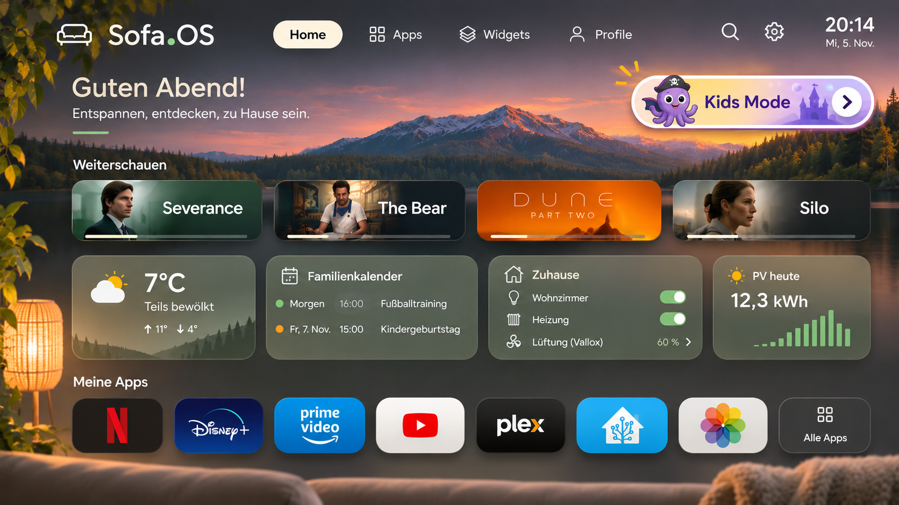

# Sofa.OS Architecture

**Architecture specification · v0.1**

*A family TV launcher and its companion web app*

*Figure 1. Mountain Sunset Dashboard. Original Sofa.OS design mockup. Titles, progress, live readings and controls illustrate the intended experience.*

Sofa.OS Home is a remote-friendly interface for apps, household widgets, family photos and an approved Kids Mode library. Sofa.OS Companion puts setup and maintenance on a phone, tablet or computer. The initial hardware target is the Samsung UE55NU8009, a 2018 Tizen 4 TV.

## Release direction

Ship Sofa.OS Home first as an installable Tizen web app opened from Samsung’s existing interface. Use the optional self-hosted server for Companion, configuration sync and integrations. Prove installation, transport and app handoff on the physical TV before committing to launcher replacement, automatic startup or title-level playback.

## How to read capability claims

**Product intent.** The launcher, companion setup, fast Kids Mode entry and unified favorites describe what the product should deliver.

**Proposed architecture.** The server layout, protocol, caching and authorization rules in this draft are implementation choices for review.

**Documented capability.** Vendor documentation establishes that an API or platform feature exists. **Device test required** means success on the target TV, firmware, provider app and account is still open. This specification records no physical TV test results.

## TV experience

*Designed for the sofa and a directional remote*

Use warm ivory, muted sage, natural materials and restrained motion. Keep text legible over both light and dark backgrounds. Give focused tiles a clear outline and preserve contrast over photography. Keep the home screen quiet with a few deliberate rows and make Kids Mode a persistent, prominent destination reachable from the main screen.

| Surface | Behavior |
| --- | --- |
| **App row** | Show selected apps and pinned favorites in household order. Present availability clearly when an app cannot be opened. |
| **Widget area** | Show glanceable cards for weather, calendar, Home Assistant, energy and photos. Use predictable size presets and explicit empty or stale states. |
| **Background and ambient view** | Choose a static background, album slideshow or in-app ambient photo view. TV-wide screensaver behavior requires a platform test. |
| **Profiles** | Allow distinct layouts and visibility settings for household and child profiles. Preserve the active restricted profile on return from a provider. |
| **Setup and status** | Keep pairing, connection status and recovery reachable from the TV. Move editing, account entry and integration setup to Companion. |

### Navigation and content discovery

The mockup shows Home, Apps, Widgets and Profile tabs, plus Search, Settings, a clock and a localized greeting. Include an All Apps destination. Scope early search to Sofa.OS items. Show Continue Watching only for providers that expose authorized progress data and have a verified resume route. The Prime Video tile represents an app shortcut candidate. The progress bars, title artwork and Home Assistant switches are design examples.

### Remote behavior

Directional keys move through an explicit focus order. OK activates the focused tile. Back closes overlays first and returns through Sofa.OS screens predictably. On resume, restore focus to the originating tile when the TV returns control. Provide a visible path back to Sofa.OS if a provider sends Back to Samsung Home. Test key handling, suspend and resume, long lists and focus recovery on hardware.

### Visual references

The original Sofa.OS mockups include the Scandinavian home screen and Kids Mode entry. The Mountain Sunset Dashboard appears in Figure 1. Companion dashboard, settings and gallery inspiration are separate visual references.

## Companion and configuration

*A responsive editor with a widescreen TV preview*

Companion runs on the local network. The Home Screen editor arranges apps, rows, widgets and backgrounds. Apps manages visibility, pinning and ordering. Widgets manages sources and presentation. Kids Mode manages profiles, approved apps, albums and favorites. Settings manages paired TVs, integrations, appearance, backups and updates. A phone remote and installable PWA are later options.

### System responsibilities

| Component | Owns |
| --- | --- |
| **Sofa.OS Home** | Remote input, rendering, local snapshot, restricted profile state and Tizen launch adapter |
| **Sofa.OS Companion** | Administrator sessions, TV selection, draft edits and responsive 16:9 preview |
| **Sofa.OS Server** | Device registration, config and policy, provider adapters and SQLite persistence |
| **External systems** | Source data from Home Assistant and Immich, plus playback and account controls inside provider apps |

### Pairing flow

1. During initial setup, Home uses the configured LAN server address to request a pairing challenge and displays a QR code and short code. The QR opens the Companion pairing page with an expiring, single-use reference. A manual code provides an alternative.
2. An authenticated administrator selects the pending TV in Companion. The TV displays the request and requires OK on the remote. The server binds the approval to that TV and issues a scoped, revocable device credential.
3. Home fetches and validates its initial configuration. The companion reports which TV received the revision. Re-pairing after a reset or revocation uses a fresh challenge.

### Edit and sync

The browser previews drafts using the same layout schema and visual tokens as Home. On publish, the server checks the expected revision and commits a validated snapshot atomically. A WebSocket signals the new revision. Home fetches the snapshot over REST, applies it and acknowledges the revision. REST polling covers dropped sockets. Keep the last valid snapshot if a revision fails validation. Keep one household with one TV in the MVP and reserve stable device identifiers and per-TV overrides for later multi-TV editing.

## Widgets and family photos

*Normalize source data on the server and keep the TV client light*

A widget declares its type, size, configuration, profile visibility and freshness policy. The server adapter returns a small display model with a timestamp and availability state. Cards fail independently so an integration outage leaves the launcher usable.

### Home Assistant and household information

Start with read-only cards for selected entities, such as temperature, household status and energy readings. Use the documented REST API for snapshots and the WebSocket API for subscribed updates. Weather and calendar can use Home Assistant entities or separate adapters. Set calendar privacy rules, such as limiting which calendars appear and hiding event details in Kids Mode. Energy cards should identify their unit and reporting period. Keep the Home Assistant token on the server. Any later scene or device action needs an explicit server allowlist and adult-only authorization. [Home Assistant REST API](https://developers.home-assistant.io/docs/api/rest/) · [Home Assistant WebSocket API](https://developers.home-assistant.io/docs/api/websocket/)

### Immich as the first photo provider

Show a small photo widget, a fullscreen album slideshow and an ambient view within Home. Let adults select family albums and separately approve child-visible albums. The server reads album and asset data, resizes or converts images when needed and delivers bounded TV-friendly thumbnails. Enforce album visibility on each media request and separate caches by profile. Confirm the installed Immich version, key permissions and supported image formats before implementation. [Immich API](https://api.immich.app/)

### Approaches for iCloud Photos

| Approach | Fit and validation |
| --- | --- |
| **Immich first** | Connect Sofa.OS to a self-hosted Immich instance. New photos can flow into Immich separately from any migration of historical images. |
| **Self-hosted bridge** | Run icloudpd as a separate sync job. Mount its output read-only as an Immich external library or serve approved images through a local gallery adapter. Test reauthentication, library rescans, deletion behavior, album mapping and any Advanced Data Protection requirements. |
| **Apple-side access** | PhotoKit can access an authorized Apple photo library on supported Apple platforms. A macOS exporter or manual export can feed Immich. Direct Tizen access to arbitrary iCloud libraries has no verified integration path here. |

The unofficial bridge owns Apple session state. Surface the last successful sync and reauthentication status while keeping the existing local library available. [Apple PhotoKit](https://developer.apple.com/documentation/photokit) · [icloudpd](https://github.com/icloud-photos-downloader/icloud_photos_downloader) · [Immich external libraries](https://docs.immich.app/features/libraries/)

## Kids Mode and favorites

*One entry point and a parent-approved collection*

From Home, one selection opens a child-friendly profile with large tiles and a small set of approved apps, favorites and albums. Adults curate the experience in Companion and can require a parent PIN to leave Kids Mode within Sofa.OS. Optional screen-time limits apply to time and actions Sofa.OS can observe. Device-wide limits and enforcement while a provider app is open require a separate mechanism.

### Unified favorites library

The library is a Sofa.OS collection that groups shows, episodes, videos and playlists across providers. Begin with parent-curated items and pasted title URLs. Add imports only where a supported interface provides authorized access to the desired collection. Imported items enter a review queue before they can appear in a child profile.

Each entry needs a stable Sofa.OS ID, provider and provider-specific identifier, title, media type, artwork reference and source. Store profile approval, sort order and optional age guidance separately from metadata. Keep the provider adapter’s launch recipe and verification record separate from the favorite. A provider or app update can invalidate a launch recipe without deleting the collection.

### What a favorite can do

| Outcome | Rule |
| --- | --- |
| **Play selected item** | Offer direct playback only when the specific playback route has passed the device test and is approved for the profile. |
| **Open title** | Send the verified title reference. The provider may still require Play, sign-in or profile selection. |
| **Open provider** | Clearly label app-only fallback. In Kids Mode, allow it only when the parent explicitly approves the handoff and configures provider-side restrictions. |
| **Unavailable** | Use a neutral unavailable state when the app is missing, the title is unavailable or the launch method is unverified for that profile. |

### Where control changes hands

The server filters what a child profile can retrieve. Home filters what it renders and can open. Once a provider app takes over, its profile, maturity settings and PIN govern its catalog. Set up and test provider-side controls, including profile switching and the Home and Back keys. Treat Kids Mode as a boundary inside Sofa.OS. On resume, reload the same child profile and enforce its current policy.

## Tizen and streaming providers

*Establish launch behavior on the UE55NU8009 before making playback promises*

Samsung documents Chromium M56 for 2018 Tizen 4 TVs, with Fetch, WebSocket and TLS 1.2 listed for that generation. Bundle a compatible, lightweight TV client and verify each dependency on hardware. The Application API documents app enumeration, launch and application controls. The receiving app decides how to handle a control request. Smart Hub Preview shows that supported apps can publish their own content links. App IDs, privilege levels and payloads still need testing with Sofa.OS’s signed package. [Samsung web engine](https://developer.samsung.com/smarttv/develop/specifications/web-engine-specifications.html) · [Application API](https://developer.samsung.com/smarttv/develop/api-references/tizen-web-device-api-references/application-api.html) · [Smart Hub Preview](https://developer.samsung.com/smarttv/develop/guides/smart-hub-preview/smart-hub-preview.html)

| Provider | Favorites input | Target TV experiment |
| --- | --- | --- |
| **Plex** | Curated server items. Explore server metadata access under the intended Plex account. | Verify app launch and Companion receiver discovery, then request a specific episode with the intended profile. Check cold and warm receiver states. |
| **YouTube** | Manual video or playlist IDs. Consider authorized Data API playlist import where supported. | Test native app handoff and a separate IFrame player path. Check embed restrictions, playback after a remote gesture and remote focus. |
| **Netflix** | Parent-curated title URL. No verified public watchlist import in scope. | Test app launch and any documented or demonstrably accepted title control. Record app-only or unavailable if title handoff fails. |
| **Disney+** | Parent-curated title URL. No verified public watchlist import in scope. | Test independently with the installed Disney+ build, actual region and intended restricted profile. |
| **Jellyfin** | Optional later adapter for server-curated media. | Explore client or custom integration independently of the Plex path. |

[Plex Companion receivers](https://support.plex.tv/articles/203082707-supported-plex-companion-apps/) · [YouTube playlists](https://developers.google.com/youtube/data/reference/rest/v3/playlists) · [YouTube embedded player](https://developers.google.com/youtube/iframe_api_reference)

### Record the observed outcome

Log model, firmware, region, package signature, app version, account/profile, target, request and result. Classify each result as unavailable, app opened, title opened or playback started. Check missing app, expired login, restricted and unavailable title, cold start, already-open app and Back or resume. A successful launch callback records dispatch. Confirm the destination and playback separately. Keep results scoped to the tested firmware, app version and profile.

## Security and offline behavior

*Keep household data local and preserve the last valid TV configuration*

Deploy the optional server as a LAN-only Docker service on a home server, with a persistent SQLite volume and separate media cache. Companion uses local administrator accounts. Each TV receives a separate device credential and access only to its assigned configuration. The server binds media access to the active profile and requires adult authorization to leave a restricted session. Use TLS for browser and TV transport and verify hostname, trust chain, clock behavior and reconnect on Chromium M56. Confirm a usable LAN address and certificate strategy before using real credentials.

### Protect configuration and media

Expire and consume pairing challenges atomically, rate-limit code and PIN attempts, and require matching on-TV approval. Store the PIN verifier as a salted password hash and enforce authorization on the server. Use secure session cookies and validate the origin of requests that change settings. Keep provider credentials and Apple sessions server-side with narrow access, secret redaction, rotation and revocation. Restrict adapter hosts and validate pasted provider IDs or URLs to prevent arbitrary fetches. Limit telemetry to local diagnostic data and redact secrets, pairing codes and sensitive media URLs.

Persist TV and profile identities, widget and app layouts, album grants, curated favorites and revisions. Back up configuration and document restore, device re-enrollment and credential rotation. Partition caches by device and profile where needed. Check approval for media requests and prevent a cached adult image or favorite from appearing in Kids Mode.

### Handle outages deliberately

| Failure | Expected behavior |
| --- | --- |
| **Server or LAN outage** | Render the last valid layout and retain the restricted profile. Show stale state for safe cached widgets. Hide sensitive assets and disable actions that need a current authorization decision. |
| **Internet or upstream outage** | Keep the local UI and available local data. Mark external cards unavailable or stale. Playback remains subject to provider connectivity. |
| **Reconnect or policy change** | Re-authenticate, fetch current revisions and clear revoked entries from profile caches before showing fresh data. Never unlock a child session because sync failed. |
| **Serverless install** | Offer built-in themes and basic on-TV configuration as a later option. Companion, sync and server adapters require the server. |

For offline Kids Mode, use the least permissive supported behavior until the server can confirm policy. Define any approved offline media and its expiry explicitly. Test TV reboot during outage, role changes, stale caches and rejection of revoked devices.

## Roadmap and open questions

*First test the TV, then publish a two-tile layout*

| Phase | Exit condition |
| --- | --- |
| **0  Hardware feasibility** | Install a signed web package on the UE55NU8009. Record firmware, signing privileges, visible app IDs and app launch behavior. Test HTTPS and WebSocket compatibility, remote keys, suspend and resume. Run the experiments for Plex, YouTube, Netflix and Disney+ in [Tizen and streaming providers](#tizen-and-streaming-providers). |
| **1  One TV MVP** | Open Home manually, pair from a phone, reorder two tiles and see the published revision on TV. Reboot offline with the saved layout, then reconnect and synchronize. Ship only launch routes that pass the target tests. |
| **2  Household features** | Add layout and widget editing, Home Assistant read-only cards, weather, calendar and energy. Ship the Immich slideshow and approved albums. Validate Kids Mode with manual favorites, guarded exit and safe handoffs. |
| **3  Broader deployment** | Add per-TV overrides, documented backup and restore, supported imports and validated title or playback adapters. Revisit standalone mode, iCloud bridge, optional remote control and PWA based on demand. |

### Decisions to resolve before expanding scope

- **Platform and distribution.** Can this signing tier list and open each desired app? How does the installed package behave after reboot or firmware updates? Is a reliable pin, startup shortcut or distribution path available on this model?
- **Provider behavior.** Which app versions and account profiles support title routing or playback? Can each provider return to the originating tile, or does the household need to reopen Home manually?
- **Household policy.** Which providers may open app-only in Kids Mode? What should happen when the server is offline? Should an optional timer track only time spent inside Sofa.OS?
- **Integration details.** Which Home Assistant entities and calendars are visible to each profile? Which Immich albums are approved, and does the household need a continuous iCloud bridge or a one-time export?
- **Operations.** Which LAN hostname and TLS setup work across the TV and mobile browsers? What are the thumbnail budget and acceptable launch latency on this hardware?

### Inspiration and prior art

These projects inform design and feasibility work. They are neither dependencies nor test results for the target TV.

| Reference | Why it matters | Limits |
| --- | --- | --- |
| **[Glass Home](https://github.com/victaphu/glass-home-samsung-tv)** | The closest prior art: a minimal Tizen home screen with a glass app dock, rotating photos, weather and phone-based setup. It documents startup workarounds and reports a 2018 Samsung NU6900 on Tizen 4.0 running with `photoService: false` and `smartHubLaunch: true`. | Samsung Home still opens Smart Hub. The 2018 report covers a different model and turns off the TV-hosted photo website. |
| **[Skippy TV](https://github.com/cascodigital/skippy-tv)** | A TV home screen with Plex and Home Assistant cards, live camera view and light controls, useful for 10-foot layout and glanceable alerts. | Built for Android TV and Fire TV, so its launcher behavior does not carry over to Tizen. Camera and light controls go beyond the read-only cards planned here. |
| **[Luma](https://github.com/funnymataleao/luma-webos-launcher)** | A remote-first TV launcher with an app row, content stacks, grid-based widgets in preset sizes, video wallpapers and a frosted-glass UI. QR pairing keeps the Home Assistant token from being typed on the TV, and devices and cameras can be hidden from the TV. | A native Rust and OpenGL ES app for LG webOS, so its code and system integration do not carry over to a Tizen web app. Its maintainer tested on an LG OLED C1, and some features require a rooted TV. Its toggles and live cameras go beyond the read-only cards planned here. |
| **[Maison](https://github.com/bnlqn/maison)** | A Home Assistant dashboard reference for weather, calendar and energy views. It shows a missing reading as a dash, never as 0, and uses a guard module to decide which writes are allowed. | Written for one house and described by its author as a reference. It targets phone, tablet and desktop rather than a TV. |
| **[Dashboard Design skill](https://github.com/abdiraimov-otabek/dashboard-design-skill)** | A Claude Code skill covering KPI tiles, charts, empty states and a screenshot QA pass, useful for widget cards and design critique. | Written for web and SwiftUI data screens, so its tooltip and filter patterns need adapting for a directional remote. |
| **[Blackbody](https://alistair-roberts.co.uk/blackbody)** | Near-black 4K wallpapers rendered from scientific data and simulations, a candidate for the background and ambient view. | Most images are CC BY-NC-ND 4.0 and two are CC BY-SA 4.0. Credit is required, and the NC-ND images do not allow commercial use or edited versions. Confirm the terms before bundling any image. They are designed for OLED screens and sized 3840 × 2400, so check their appearance on the target TV. |
| **[Home Assistant on a Samsung TV](https://www.reddit.com/r/homeassistant/comments/1xj41b0/ive_got_my_entire_home_assistant_dashboard/)** | A community build that installs a full Home Assistant dashboard as a Tizen app on a 2022 Samsung The Frame, using arrow-key navigation, a visible focus highlight and Back to return toward navigation or the launcher. It starts from [CleanFrame](https://github.com/nthnclrk/CleanFrame) and reports the Home button returning to the launcher from Netflix and YouTube. | The TV runs Tizen 6.5, which is newer than the target. The Home button method is undocumented, experimental and firmware-specific, so it needs a recovery backup and the original Home settings restored before uninstalling. The dashboard's device controls go beyond the read-only cards planned here. |

One Home Assistant community post is also saved for later review. Its contents have not been reviewed for this specification: [Home Assistant controls and live cameras](https://www.reddit.com/r/homeassistant/comments/1xokv2i/i_added_home_assistant_controls_and_live_cameras/)

### Design and installation references

[Mountain Sunset Dashboard mockup](sofa-os-mountain-sunset-dashboard.png) · [Samsung TV developer setup](https://developer.samsung.com/smarttv/develop/tools/additional-tools/vscode/connecting-to-tv-device.html) · [Samsung installation Q&A](https://developer.samsung.com/smarttv/develop/faq/application-installation.html) · [Netflix parental controls](https://help.netflix.com/en/node/53045)
