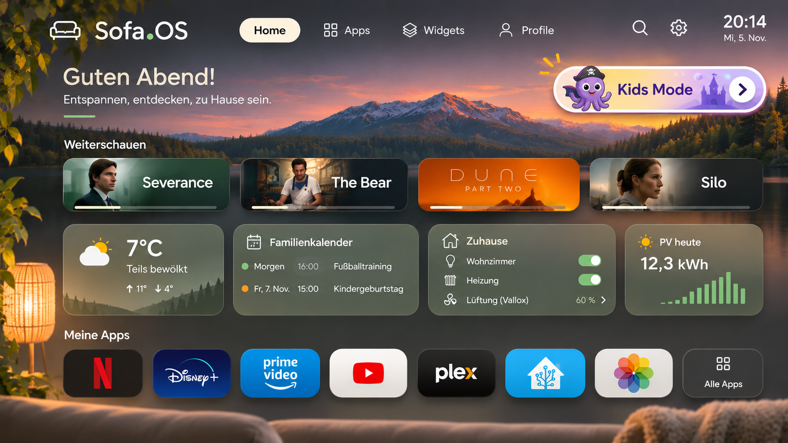

# Sofa.OS Architecture

**Architecture specification · v0.2**

*A family TV screen and its companion web app*

*Figure 1. Mountain Sunset Dashboard. Original Sofa.OS design mockup. Titles, progress, live readings and controls illustrate the intended experience.*

Sofa Home is a remote-friendly screen for apps, household widgets, family photos and Kids Mode. Companion puts setup and maintenance on a phone, tablet or computer. Sofa.OS is built for one household and one TV, the Samsung UE55NU8009, a 2018 Tizen 4 TV. Terms are defined in [CONTEXT.md](../CONTEXT.md).

## Release direction

Ship Sofa Home as a signed, full-screen Tizen web app that opens at power-on. It sits on top of Samsung Home and does not replace it: the launcher is firmware and a sandboxed app cannot take its place. The Server is required for Companion, configuration sync, integrations and Kids Mode. Start from the CleanFrame Tizen 4 build as a skeleton only, and own the design and code from there.

## How to read capability claims

**Product intent.** Kids Mode, the Watch Allowance, Companion setup and the Phone Remote describe what the product should deliver.

**Proposed architecture.** The server layout, protocol and caching in this draft are implementation choices for review.

**Documented capability.** Vendor documentation establishes that an API or platform feature exists. **Device test required** means success on the target TV, firmware, provider app and account is still open.

### Known results

Scoped to firmware T-KTM2DEUC 1400.2. Source: the `app-development` track of the tizen-research repository.

| Result | Status |
| --- | --- |
| **Signed Tizen 4 package** | CleanFrame 0.6.1 was built with `required_version` lowered to 4.0, signed and validated live: install, navigation, app launching, editor, Home key escape and TV settings all work. |
| **Sofa Home skeleton** | Tested 2026-11-07 with `tv/` (package `sofahome01`, app ID `sofahome01.SofaHome`) on the TV at its ethernet address. Power-on auto-launch, Home key escape and return, and standby wake all work, as reported by the user at the TV. Arrows are key codes 37 to 40, OK is 13, Back is 10009 (`XF86Back`), Play/Pause is 10252, and a 2.5 s hold of OK arrived as one `keydown` and one `keyup`. Colour keys (403 to 406) deliver only `keyup` until the app registers them with `tizen.tvinputdevice.registerKey`, and then deliver both. All 21 keys tried registered. The remote has only Power, 123, Extra, the directional ring with OK, Back, Home, Play/Pause, VOL and CH, so there is no Menu, Info or dedicated colour key. Volume, channel and 123 were not tested. Power-on launch uses Smart Hub's Smart Features > Start Last App setting. |
| **Launcher replacement** | Not possible from a sandboxed app. |
| **Home Assistant control** | The TV is integrated. Its media player advertises turn-off but not turn-on, lists the installed apps as sources, and a remote entity exists. Key forwarding through the remote entity works. Turn-off and the rest are not yet exercised for Sofa.OS. |
| **Long press** | Tested 2026-11-07 with a signed test app. The real remote sends one `keydown` and one `keyup` with no repeats, and OK is key code 13. Home Assistant accepts `hold_secs` on `remote.send_command` but ignores it: a 2-second hold arrived as a 12 ms press. |
| **Provider metadata** | Read 2026-11-07 with a signed probe app using `tizen.application.getAppMetaData`. Plex and Disney+ publish previews through a background service. Netflix, Prime Video and YouTube publish no preview metadata. Plex declares the search format `{"assetId":"%%CONTENT_ID%%"}`, and ARD and ZDF declare `%%CONTENT_ID%%`. YouTube declares `#play?v=` as its search link. ARD and ZDF name public Smart Hub feeds. KiKA 2.0.0 declares neither a preview nor a search format. |
| **Smart Hub Preview launch** | Checked offline 2026-11-07 against Samsung's docs and this firmware. Selecting a preview tile launches its app with the app control operation `http://samsung.com/appcontrol/operation/eden_resume` and a `PAYLOAD` entry whose JSON `values` holds the tile's `action_data`. The firmware's preview downloader and launch bridge both handle `action_data`, `PAYLOAD` and `values`. ARD's feed links series pages as `ard://grouping/<base64 CRID>`, and none are marked playable. ZDF's feed is empty. A third-party app may send this request, as the title handoff test shows. |
| **Title handoff** | Tested 2026-11-07 with a signed test app that sent each provider an app control request. ARD opened the requested series page from the Smart Hub Preview request: title opened. KiKA, ZDF, Plex and YouTube reached only app opened. Plex ignored three payload forms carrying a content ID, and YouTube ignored four forms of a video link. YouTube launched this way starts signed out, like a first start, while its normal sign-in stays intact. Netflix opens through `org.tizen.netflix-app`, while the store ID `RN1MCdNq8t.Netflix` leaves a black screen. With Plex open, the TV exposes no Plex Companion player port and does not answer local Plex discovery. |
| **Plex on this TV** | Tested 2026-11-07 across one episode change and one pause. Home Assistant's Plex client entity reports the show, season, episode, content ID, duration, position and rating during playback. The TV's own media player shows no current app or title. |

## TV experience

*Designed for the sofa and a directional remote*

Use warm ivory, muted sage, natural materials and restrained motion. Keep text legible over both light and dark backgrounds. Give focused tiles a clear outline and preserve contrast over photography. Keep the Dashboard quiet with a few deliberate rows and make Kids Mode a persistent, prominent destination.

| Surface | Behavior |
| --- | --- |
| **App row** | Show selected apps in household order. Present availability clearly when an app cannot be opened. |
| **Widget area** | Show glanceable cards for weather, calendar, Home Assistant, energy and photos. Use predictable size presets and explicit empty or stale states. OK opens a full-screen view and a long press opens a context menu. |
| **Background and ambient view** | Choose a static background, album slideshow or in-app ambient photo view. TV-wide screensaver behavior requires a platform test. |
| **Profiles** | Exactly two: the household profile and one Kids Mode profile. Children share the Kids Mode profile and its Watch Allowance. |
| **Setup and status** | Keep TV Sign-in, connection status and recovery reachable from the TV. Move editing, account entry and integration setup to Companion. The exception is arranging widgets from their context menu. |

### Navigation and content discovery

Sofa Home has Dashboard, Apps and Widgets tabs, plus Settings, a clock and a greeting. All interface text is English. Figure 1 still shows some German, a Search icon and a Profile tab, but Sofa.OS has no search and no Profile tab: Kids Mode is entered from the Dashboard. Include an All Apps destination. Continue Watching, the progress bars, title artwork and Home Assistant switches in the mockup are design examples and are out of scope. The Prime Video tile represents an app shortcut candidate.

### Remote behavior

Directional keys move through an explicit focus order. OK activates the focused tile. Holding OK on a widget opens its context menu. Back closes overlays first and returns through Sofa.OS screens predictably. On resume, restore focus to the originating tile when the TV returns control. Provide a visible path back to Sofa Home if a provider sends Back to Samsung Home. Test key handling, suspend and resume, long lists and focus recovery on hardware.

### Visual references

The original Sofa.OS mockups include the Scandinavian home screen and Kids Mode entry. The Mountain Sunset Dashboard appears in Figure 1. Companion dashboard, settings and gallery inspiration are separate visual references.

## Companion and configuration

*A responsive editor with a widescreen TV preview*

Companion is an installable PWA served over HTTPS and reachable only from the LAN or VPN. The Home Screen editor arranges apps, rows, widgets and backgrounds. Apps manages visibility and ordering. Widgets manages sources and presentation. Kids Mode manages approved apps, albums and the Watch Allowance. Settings manages the TV, integrations, appearance, backups and updates.

The Phone Remote is a Companion page that controls the whole TV, including inside provider apps. The page sends keys to the Server, which forwards them through the Home Assistant remote entity. A browser page cannot reach the TV's own network API directly, so the Server stays in the path either way. The Menu button is the exception to key forwarding, as described in [Widget interaction](#widget-interaction).

### System responsibilities

| Component | Owns |
| --- | --- |
| **Sofa Home** | Remote input, rendering, local snapshot, active profile and Tizen launch adapter |
| **Companion** | The administrator session, draft edits, responsive 16:9 preview and Phone Remote |
| **Server** | TV Sign-in, config and policy, the Watch Allowance clock, provider adapters and SQLite persistence |
| **External systems** | Source data from Home Assistant and Immich, TV power and key commands through Home Assistant, and playback and account controls inside provider apps |

### TV Sign-in

This works like signing in to a streaming app on a TV.

1. Sofa Home, configured with the Server address, requests a short-lived code and displays it as a QR code.
2. The QR code opens the Companion sign-in page on a phone. The adult enters the Companion password.
3. The Server issues a device token, and Sofa Home stores it and fetches its configuration. After a TV reset, sign in again.

### Edit and sync

The browser previews drafts using the same layout schema and visual tokens as Sofa Home. On publish, the Server commits a validated snapshot atomically. A WebSocket signals the new revision, and Sofa Home fetches the snapshot over REST and applies it. REST polling covers dropped sockets. Keep the last valid snapshot if a revision fails validation.

Widget changes made on the TV go through the same path: the Server commits them as a new revision, and they also apply to any open Companion draft, so publishing that draft does not undo them. Without the Server, the TV cannot change the layout.

## Widgets and family photos

*Normalize source data on the Server and keep the TV client light*

A widget declares its type, size, configuration, profile visibility and freshness policy. The Server adapter returns a small display model with a timestamp and availability state. Cards fail independently so an integration outage leaves Sofa Home usable. Widget types are defined in Server code and rendered through a fixed set of display templates. See [ADR 0003](adr/0003-widget-catalogue-lives-in-server-code.md).

### Widget interaction

| Action | Behavior |
| --- | --- |
| **OK on a widget** | Opens a full-screen view with more detail, on the Dashboard and in the Widgets tab. Back returns to the originating widget. The photo widget opens the ambient view. |
| **Long press on the Dashboard** | Opens a context menu with Move and Remove from Dashboard. Move lifts the widget: left and right reorder it, OK places it and Back cancels. |
| **Long press in the Widgets tab** | Opens a context menu with Add to Dashboard, for widgets not already there. |

The full-screen view is read-only, like the cards. Its display model carries the extra detail, and missing readings still show as a dash.

Sofa Home detects a long press by timing the gap between `keydown` and `keyup`, because a held key sends no repeat events. Home Assistant cannot forward a hold, so the Phone Remote has a Menu button instead. The Server sends the request over the WebSocket Sofa Home already uses, and Sofa Home opens the context menu for the focused widget. The button does nothing inside a provider app, and it needs that WebSocket to be connected.

### Home Assistant and household information

Start with read-only cards for selected entities, such as temperature, household status and energy readings. Use the documented REST API for snapshots and the WebSocket API for subscribed updates. Weather can use Home Assistant entities or a separate adapter. Energy cards should identify their unit and reporting period. Show a missing reading as a dash, never as 0. Keep the Home Assistant token on the Server.

The Server may write to Home Assistant in exactly three ways:

- Turn this TV off when the Watch Allowance reaches zero.
- Send the Watch Allowance notification to the adults' phones.
- Forward Phone Remote keys to this TV.

Any other scene or device action needs an explicit allowlist and a new decision. [Home Assistant REST API](https://developers.home-assistant.io/docs/api/rest/) · [Home Assistant WebSocket API](https://developers.home-assistant.io/docs/api/websocket/)

### Family calendar

The shared iCloud calendar reaches Sofa.OS through Home Assistant. Home Assistant's CalDAV integration connects to `https://caldav.icloud.com/` with an app-specific password, so the Apple credential stays in Home Assistant and the Server needs no iCloud connection. Set it up in the UI, because the YAML setup that can filter calendars does not support all-day events by default.

The Server reads upcoming events with `calendar.get_events`, because a calendar entity's state shows only the next event. This action is a read and does not count as one of the three writes above. Home Assistant refreshes calendars about every 15 minutes, so a new event can take that long to appear. Sofa.OS never writes to the calendar.

Home Assistant may import every calendar on the Apple Account, so the Server reads only an allowlist of calendar entities. The Server also removes event details for Kids Mode before data reaches the TV. A direct CalDAV adapter on the Server is the fallback if 15 minutes proves too slow.

Tested against the household's Home Assistant on 2026-11-07, the shared calendar appears as `calendar.family`. Recurring events arrive as separate occurrences, with skipped weeks, moved occurrences and the daylight saving change handled correctly. All-day events arrive with date-only values and an exclusive end date, including multi-day events. This shapes the adapter in two ways:

- Events do not arrive in date order, so sort by start time before limiting the list.
- Occurrences of a recurring event share a `uid`, so identify each one by `uid` plus `recurrence_id`.

Event titles appear as written, so they can be German in the English interface. The calendar holds private details such as medical appointments and addresses, so decide what each profile shows. Still untested are the Server's own `calendar.get_events` call and the 15-minute delay. [Home Assistant CalDAV](https://www.home-assistant.io/integrations/caldav/) · [Get calendar events](https://www.home-assistant.io/actions/calendar.get_events/)

### Immich as the first photo provider

Show a small photo widget, a fullscreen album slideshow and an ambient view within Sofa Home. Let adults select family albums and separately approve child-visible albums. The Server reads album and asset data, resizes or converts images when needed and delivers bounded TV-friendly thumbnails. The Server filters albums by active profile. Confirm the installed Immich version, key permissions and supported image formats before implementation. [Immich API](https://api.immich.app/)

### Parked: iCloud Photos

Direct Tizen access to iCloud has no verified path. If needed later, feed Immich from a separate sync job or a manual export. [icloudpd](https://github.com/icloud-photos-downloader/icloud_photos_downloader) · [Immich external libraries](https://docs.immich.app/features/libraries/)

## Kids Mode

*A calm, approved front door with a daily allowance*

From the Dashboard, one selection opens a child-friendly profile with large tiles and a small set of approved apps and albums. Adults curate it in Companion. Kids Mode is curation, not containment: provider-side controls do the actual restricting, and the Home key always reaches Samsung Home. See [ADR 0001](adr/0001-kids-mode-is-curation-not-containment.md).

### Watch Allowance

The Server owns the clock, so it keeps running if a child leaves through the Home key or a provider app.

| Rule | Behavior |
| --- | --- |
| **Unit** | Minutes, for every provider. |
| **Clock** | Runs while Kids Mode is active and the TV is on, including browsing and pauses. Stops when the TV is off or an adult exits Kids Mode. |
| **Budget** | One daily budget, shared by all children, reset overnight. Time left over carries across sittings within the day. |
| **Warning** | Five minutes before zero, the Server sends a Home Assistant mobile notification to both adults' iPhones with **+5 min**, **+10 min** and **Custom** actions. Sofa Home cannot draw over a provider app, so the TV shows no warning. |
| **Top-up** | A notification action or Companion adds minutes to today's budget. |
| **Zero** | The Server turns the TV off through Home Assistant, even mid-episode. |
| **Return** | When the TV comes back on, Sofa Home shows the Done Screen. An adult leaves it with the PIN. |

Later: a spike checks whether Home Assistant's Plex entity supports episode-based allowances, such as "two Paw Patrol episodes, then the TV turns off". This could only work for Plex. First tests look workable:

| Event | Entity reports | Server action |
| --- | --- | --- |
| **Playing** | `playing`, with a position and `media_position_updated_at` | Predict the end as that timestamp plus the remaining duration. The position does not tick between updates. |
| **Pause** | `paused`, with details kept and the position frozen | Do not count. |
| **Resume** | `playing`, with the same position and a fresh timestamp | Predict the end again. |
| **Episode ends** | `idle` at the predicted end, with details cleared | Count one episode. Keep the last content ID, because `idle` clears it. |
| **Next episode** | `playing`, with a new content ID and position 0 | Start again. |

The tested gap between episodes was 17 seconds, so the Server could turn the TV off before the next episode starts. The entity becomes `unavailable` after a while without playback, which means nothing is known. `sensor.plex_rei3` counts every session on the Plex server, so do not use it. Still untested are stopping mid-episode, seeking, episodes that end without autoplay, and whether `KEY_PAUSE` works in Plex.

### Where control changes hands

The Server filters what the Kids Mode profile can retrieve. Sofa Home filters what it renders and can open. Once a provider app takes over, its profile, maturity settings and PIN govern its catalog, so set up provider-side controls for each approved app. On resume, reload Kids Mode and apply its current policy.

### Later: favorites library

Kids Mode starts with approved app tiles, plus Plex titles if title handoff passes its device test. A unified favorites library across providers waits for the provider experiments. If built, it is parent-curated with no imports. Each favorite keeps a provider identifier separate from its launch recipe, so a provider update can invalidate a recipe without deleting the item. A favorite's launch recipe starts playback, opens the title or opens the app, according to what passed the device test, and shows a neutral unavailable state otherwise.

## Tizen and streaming providers

*Establish launch behavior on the UE55NU8009 before making playback promises*

Samsung documents Chromium M56 for 2018 Tizen 4 TVs, with Fetch, WebSocket and TLS 1.2 listed for that generation. Bundle a compatible, lightweight TV client and verify each dependency on hardware. The Application API documents app enumeration, launch and application controls. The receiving app decides how to handle a control request. Smart Hub Preview shows that supported apps can publish their own content links. [Samsung web engine](https://developer.samsung.com/smarttv/develop/specifications/web-engine-specifications.html) · [Application API](https://developer.samsung.com/smarttv/develop/api-references/tizen-web-device-api-references/application-api.html) · [Smart Hub Preview](https://developer.samsung.com/smarttv/develop/guides/smart-hub-preview/smart-hub-preview.html)

| Provider | Target TV experiment |
| --- | --- |
| **KiKA** | The most important provider for Kids Mode, so test it first. Installed as `mvOizTfhQn.KiKAplayer`. Read its metadata, then test app launch and any title handoff. Record app opened if title handoff fails. |
| **ARD** | Installed as `SrAoJxGQUf.ARD`. Test title handoff with a content ID taken from its public Smart Hub feed. |
| **ZDF** | Installed as `yPSlpvfeTf.ZDFmediathek`. Test title handoff with a content ID taken from its public Smart Hub feed. |
| **Plex** | Verify app launch and Companion receiver discovery, then request a specific episode with the intended profile. Check cold and warm receiver states. As a fallback, test app control with the declared `assetId` format. |
| **YouTube** | Test native app handoff and a separate IFrame player path. Check embed restrictions, playback after a remote gesture and remote focus. |
| **Netflix** | Test app launch and any documented or demonstrably accepted title handoff. Record app opened or unavailable if title handoff fails. |

Other installed apps, such as Disney+, Prime Video and YouTube Kids, get app tiles only and no experiments.

[Plex Companion receivers](https://support.plex.tv/articles/203082707-supported-plex-companion-apps/) · [YouTube embedded player](https://developers.google.com/youtube/iframe_api_reference)

### Record the observed outcome

Log firmware, app version, account/profile, target, request and result. Classify each result as unavailable, app opened, title opened or playback started. A successful launch callback records dispatch only, so confirm the destination and playback separately.

## Security and offline behavior

*One household on a trusted LAN. See [ADR 0002](adr/0002-single-household-on-a-trusted-lan.md).*

Deploy the Server as a Docker service on the home server, with a persistent SQLite volume and separate media cache, behind the existing Caddy reverse proxy. Companion uses HTTPS with the existing Let's Encrypt setup and accepts only LAN or VPN clients. One Companion password protects administration, with secure session cookies.

Sofa Home uses the same HTTPS address if Chromium M56 accepts the certificate in Phase 0. If it does not, the TV uses plain HTTP on the LAN, and anyone on the Wi-Fi could read that traffic.

Store the PIN as a salted hash. Keep provider, Home Assistant and Immich credentials on the Server. The Apple app-specific password for the calendar stays in Home Assistant. Validate provider IDs and URLs so adapters cannot make arbitrary fetches. Back up the SQLite database and configuration.

### Handle outages deliberately

| Failure | Expected behavior |
| --- | --- |
| **Server or LAN outage** | Render the last valid layout and mark widgets stale. The Kids Mode tile shows as unavailable, and adults can still use the TV. |
| **Server outage during Kids Mode** | The clock and switch-off stop working, so the TV stays on. |
| **Internet or upstream outage** | Keep the local UI and available local data. Mark external cards unavailable or stale. Playback remains subject to provider connectivity. |
| **Home Assistant outage** | No warning, Top-up by notification, switch-off or Phone Remote. Companion shows the outage. |
| **Reconnect** | Fetch the current revision before showing fresh data. |

## Roadmap and open questions

*First test the TV, then make one Kids Mode evening work*

| Phase | Exit condition |
| --- | --- |
| **0  Hardware feasibility** | Build a Sofa Home package from the CleanFrame skeleton. Confirm power-on auto-launch. Test HTTPS with the Let's Encrypt certificate, WebSocket, remote keys, suspend and resume. Test Home Assistant turn-off, reliable TV on/off state and remote keys. Run the provider experiments in [Tizen and streaming providers](#tizen-and-streaming-providers). |
| **1  Kids Mode evening** | Sofa Home opens at power-on and TV Sign-in connects it. App tiles launch providers and Kids Mode starts the Watch Allowance. The notification and Top-up work. The TV switches off at zero and the Done Screen appears on return. |
| **2  Household features** | Add layout and widget editing, Home Assistant read-only cards, weather, calendar and energy. Ship the Immich slideshow and approved albums. |
| **3  Convenience** | Add the Phone Remote and installable PWA. Add validated title handoff and the favorites library if the experiments support them. Finish the Plex episode spike. |

### Decisions to resolve

- **Platform.** How does auto-launch behave after reboot and firmware updates? Does the signed package survive them?
- **Provider behavior.** Which apps support title handoff? Can each provider return to the originating tile, or does the household reopen Sofa Home manually?
- **Household policy.** Which apps are approved in Kids Mode, and what is the daily allowance? Is counting pauses against the clock acceptable in practice? Does a hard switch-off need a grace period?
- **Integration details.** Which Home Assistant entities, calendars and Immich albums are visible in each profile?
- **Operations.** What are the thumbnail budget and acceptable launch latency on this hardware?

### Inspiration and prior art

These projects inform design and feasibility work. They are neither dependencies nor test results for the target TV.

| Reference | Why it matters | Limits |
| --- | --- | --- |
| **[Glass Home](https://github.com/victaphu/glass-home-samsung-tv)** | The closest prior art: a minimal Tizen home screen with a glass app dock, rotating photos, weather and phone-based setup. It documents startup workarounds and reports a 2018 Samsung NU6900 on Tizen 4.0 running with `photoService: false` and `smartHubLaunch: true`. | Samsung Home still opens Smart Hub. The 2018 report covers a different model and turns off the TV-hosted photo website. |
| **[Skippy TV](https://github.com/cascodigital/skippy-tv)** | A TV home screen with Plex and Home Assistant cards, live camera view and light controls, useful for 10-foot layout and glanceable alerts. | Built for Android TV and Fire TV, so its launcher behavior does not carry over to Tizen. Camera and light controls go beyond the read-only cards planned here. |
| **[Luma](https://github.com/funnymataleao/luma-webos-launcher)** | A remote-first TV launcher with an app row, content stacks, grid-based widgets in preset sizes, video wallpapers and a frosted-glass UI. QR pairing keeps the Home Assistant token from being typed on the TV, and devices and cameras can be hidden from the TV. | A native Rust and OpenGL ES app for LG webOS, so its code and system integration do not carry over to a Tizen web app. Its maintainer tested on an LG OLED C1, and some features require a rooted TV. Its toggles and live cameras go beyond the read-only cards planned here. |
| **[Maison](https://github.com/bnlqn/maison)** | A Home Assistant dashboard reference for weather, calendar and energy views. It shows a missing reading as a dash, never as 0, and uses a guard module to decide which writes are allowed. | Written for one house and described by its author as a reference. It targets phone, tablet and desktop rather than a TV. |
| **[Dashboard Design skill](https://github.com/abdiraimov-otabek/dashboard-design-skill)** | A Claude Code skill covering KPI tiles, charts, empty states and a screenshot QA pass, useful for widget cards and design critique. | Written for web and SwiftUI data screens, so its tooltip and filter patterns need adapting for a directional remote. |
| **[Blackbody](https://alistair-roberts.co.uk/blackbody)** | Near-black 4K wallpapers rendered from scientific data and simulations, a candidate for the background and ambient view. | Most images are CC BY-NC-ND 4.0 and two are CC BY-SA 4.0. Credit is required, and the NC-ND images do not allow commercial use or edited versions. Confirm the terms before bundling any image. They are designed for OLED screens and sized 3840 × 2400, so check their appearance on the target TV. |
| **[Home Assistant on a Samsung TV](https://www.reddit.com/r/homeassistant/comments/1xj41b0/ive_got_my_entire_home_assistant_dashboard/)** | A community build that installs a full Home Assistant dashboard as a Tizen app on a 2022 Samsung The Frame, using arrow-key navigation, a visible focus highlight and Back to return toward navigation or the launcher. It starts from [CleanFrame](https://github.com/nthnclrk/CleanFrame) and reports the Home button returning to the launcher from Netflix and YouTube. | The TV runs Tizen 6.5, which is newer than the target. The Home button method is undocumented, experimental and firmware-specific, so it needs a recovery backup and the original Home settings restored before uninstalling. The dashboard's device controls go beyond the read-only cards planned here. |

One Home Assistant community post is also saved for later review. Its contents have not been reviewed for this specification: [Home Assistant controls and live cameras](https://www.reddit.com/r/homeassistant/comments/1xokv2i/i_added_home_assistant_controls_and_live_cameras/)

### Design and installation references

[Mountain Sunset Dashboard mockup](sofa-os-mountain-sunset-dashboard.png) · [Samsung TV developer setup](https://developer.samsung.com/smarttv/develop/tools/additional-tools/vscode/connecting-to-tv-device.html) · [Samsung installation Q&A](https://developer.samsung.com/smarttv/develop/faq/application-installation.html) · [Netflix parental controls](https://help.netflix.com/en/node/53045)
